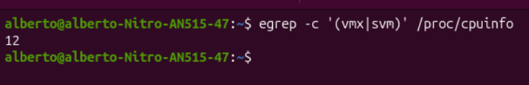
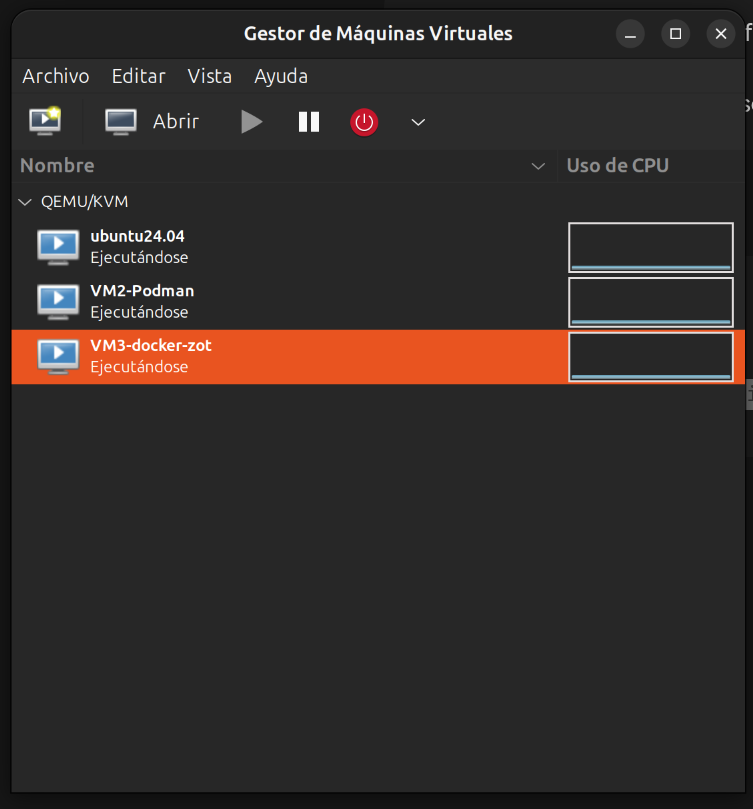
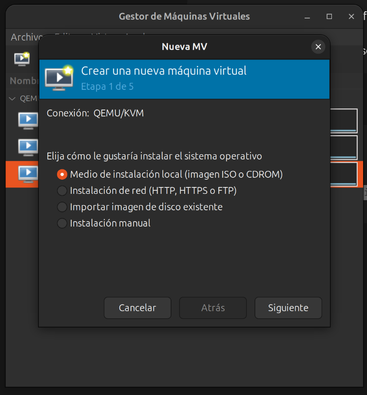
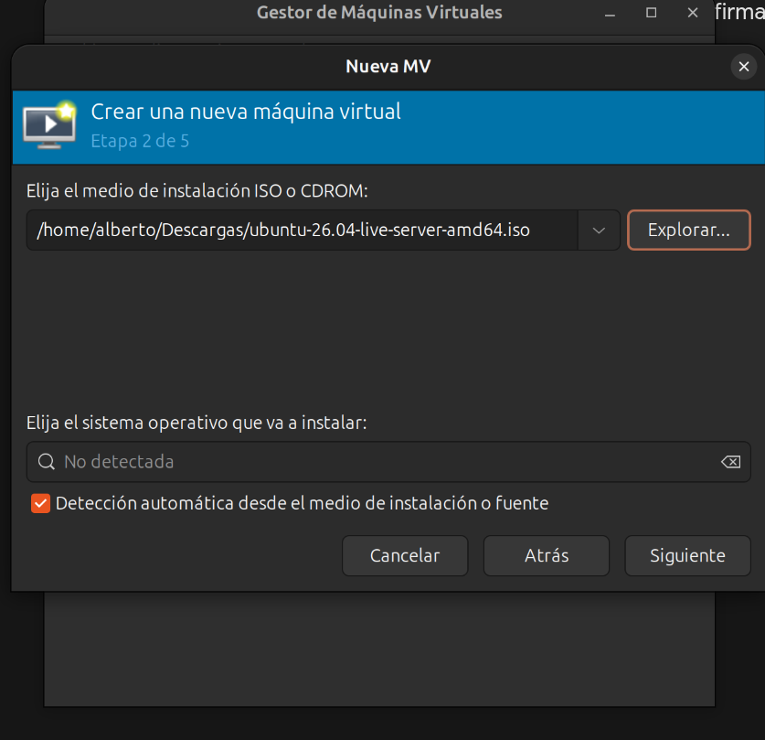
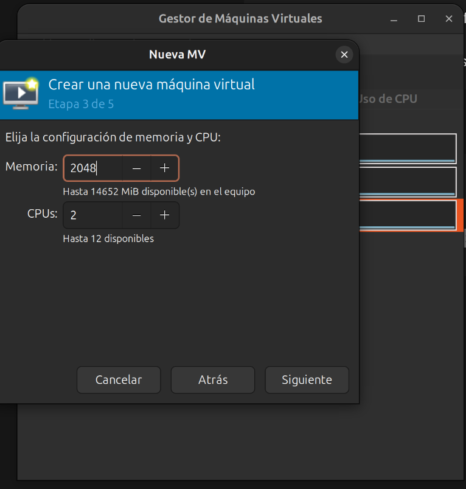
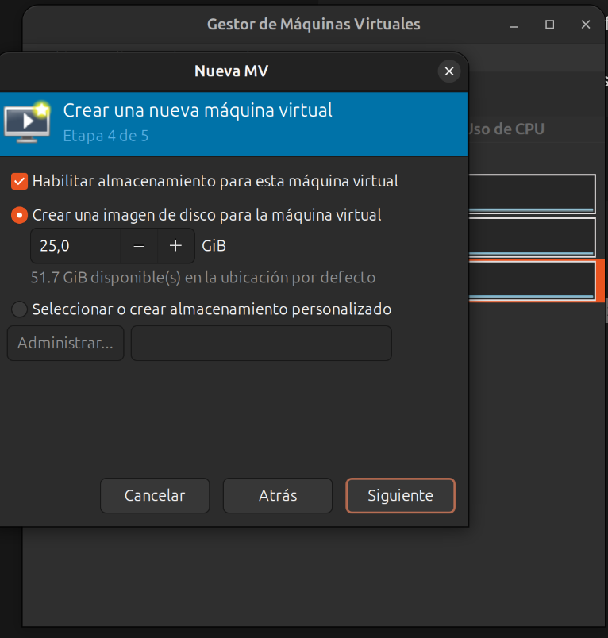
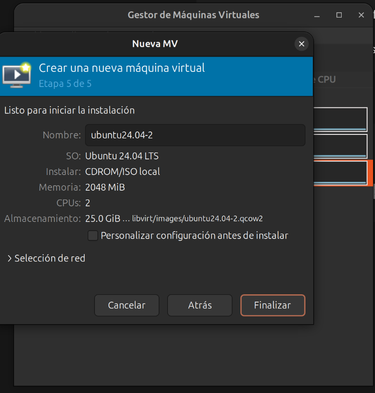

# Guía de Instalación
## Proyecto 1 — Sistemas Operativos 1

Esta guía describe, paso a paso, cómo levantar desde cero el entorno completo del proyecto: 3 máquinas virtuales, sus runtimes de contenedores, las 3 APIs en Go, y el registro privado de imágenes Zot.

---

## Requisitos previos

- Host Ubuntu/Debian con virtualización activa en BIOS (Intel VT-x / AMD-V)
- 8 GB de RAM libres como mínimo
- 60 GB de espacio en disco libre
- Conexión a internet

Verificar virtualización activa:
```bash
egrep -c '(vmx|svm)' /proc/cpuinfo
```
Un resultado mayor a `0` confirma que está activa.



---

## Paso 1 — Instalar KVM y virt-manager en el host

```bash
sudo apt update
sudo apt install -y qemu-system-x86 libvirt-daemon-system libvirt-clients bridge-utils virt-manager
```

Verificar que el servicio está corriendo:
```bash
sudo systemctl status libvirtd
sudo virsh net-list --all
```
Debe aparecer la red `default` en estado `activo`.

> Si `virt-manager` no puede conectar, ábrelo con `sudo virt-manager`.




---

## Paso 2 — Descargar la ISO de Ubuntu Server

```bash
mkdir -p ~/vm-isos && cd ~/vm-isos
wget https://releases.ubuntu.com/24.04/ubuntu-24.04.1-live-server-amd64.iso
```

---

## Paso 3 — Crear las 3 máquinas virtuales

Repetir 3 veces desde `virt-manager` (ícono "Crear nueva máquina virtual"):

| Parámetro | Valor |
|---|---|
| Medio de instalación | ISO descargada en el paso 2 |
| Sistema operativo | Ubuntu 24.04 LTS |
| Memoria | 2048 MB |
| CPUs | 2 |
| Disco | 15-20 GB |
| Red | Red virtual `default` (NAT) |
| Nombres | `VM1-containerd`, `VM2-Podman`, `VM3-docker-zot` |













Durante la instalación de Ubuntu Server en cada VM:

1. Idioma y teclado → según preferencia
2. Tipo de instalación → **Ubuntu Server** (no la versión "minimized")
3. Red → dejar DHCP automático, **anotar la IP asignada**
4. Proxy y Mirror → dejar valores por defecto
5. Storage → usar el layout automático de todo el disco, confirmar
6. Perfil: definir hostname (`vm1-containerd`, `vm2-podman`, `vm3-docker-zot`), usuario y contraseña
7. **SSH configuration → marcar `[X] Instalar servidor OpenSSH`** (obligatorio)
8. Featured Server Snaps → no seleccionar ninguno
9. Esperar la instalación → **Reboot Now** → Enter para retirar el medio

### Registro de IPs (ejemplo obtenido en este proyecto)

| VM | IP |
|---|---|
| VM1 (containerd) | `192.168.122.179` |
| VM2 (podman) | `192.168.122.241` |
| VM3 (docker/zot) | `192.168.122.112` |

---


## Paso 4 — Verificar acceso a las VMs

Desde cada consola gráfica:
```bash
hostname
ip a
```

Desde el host, probar SSH:
```bash
ssh usuario@<ip-vm1>
ssh usuario@<ip-vm2>
ssh usuario@<ip-vm3>
```

Probar que las VMs se ven entre sí:
```bash
ping -c 3 <ip-de-otra-vm>
```

Actualizar cada VM:
```bash
sudo apt update && sudo apt upgrade -y
```

---

## Paso 5 — Instalar el runtime en cada VM

### VM1 — Containerd + nerdctl

```bash
sudo apt update
sudo apt install -y containerd
sudo systemctl enable --now containerd
```

```bash
cd /tmp
wget https://github.com/containerd/nerdctl/releases/download/v2.0.2/nerdctl-2.0.2-linux-amd64.tar.gz
sudo tar -xzf nerdctl-2.0.2-linux-amd64.tar.gz -C /usr/local/bin
```

Plugins CNI (necesarios para redes de contenedores):
```bash
sudo mkdir -p /opt/cni/bin
wget https://github.com/containernetworking/plugins/releases/download/v1.6.2/cni-plugins-linux-amd64-v1.6.2.tgz
sudo tar -xzf cni-plugins-linux-amd64-v1.6.2.tgz -C /opt/cni/bin
```

BuildKit (necesario para construir imágenes):
```bash
wget https://github.com/moby/buildkit/releases/download/v0.19.0/buildkit-v0.19.0.linux-amd64.tar.gz
sudo tar -xzf buildkit-v0.19.0.linux-amd64.tar.gz -C /usr/local
sudo /usr/local/bin/buildkitd > /tmp/buildkitd.log 2>&1 &
```

Prueba:
```bash
sudo nerdctl run --rm hello-world
```

### VM2 — Podman

```bash
sudo apt update
sudo apt install -y podman
```

Prueba:
```bash
podman run --rm hello-world
```

### VM3 — Docker

```bash
sudo apt update
sudo apt install -y docker-ce docker-ce-cli containerd.io docker-buildx-plugin docker-compose-plugin
```

Prueba:
```bash
sudo docker run --rm hello-world
```

---

## Paso 6 — Preparar el código de las APIs (en el host)

```bash
mkdir -p ~/proyecto1-so1/api
cd ~/proyecto1-so1/api
go mod init api
```

Crear `main.go` con el código fuente de la API (ver Manual Técnico, sección 6.2).

Duplicar en 3 carpetas, una por API, cada una con su `Dockerfile`:
```bash
cd ~/proyecto1-so1
mkdir -p api1 api2 api3
cp api/main.go api/go.mod api1/
cp api/main.go api/go.mod api2/
cp api/main.go api/go.mod api3/
```

El `Dockerfile` (idéntico en las 3 carpetas) usa un build de 2 etapas: compila con la imagen `golang:1.26-alpine` y copia el binario resultante a una imagen `alpine:latest` mínima.

---

## Paso 7 — Copiar el código a cada VM

```bash
scp -r api1 usuario@<ip-vm1>:~/
scp -r api2 usuario@<ip-vm2>:~/
scp -r api3 usuario@<ip-vm3>:~/
```

---

## Paso 8 — Construir y ejecutar cada API

> **Importante:** los nombres de imagen deben ir en minúsculas (`api1-202300559`, no `API1-202300559`) por requisito del estándar OCI/Docker.

### En VM1 (nerdctl)

```bash
cd ~/api1
sudo nerdctl build -t api1-202300559:v1 .

sudo nerdctl run -d --name api1-test -p 8080:8080 \
  -e API_ID=1 -e VM_ID=VM1 -e PORT=8080 \
  -e API2_URL=http://<ip-vm2>:8081 -e API2_VM=VM2 \
  -e API3_URL=http://<ip-vm3>:8082 -e API3_VM=VM3 \
  api1-202300559:v1
```

### En VM2 (podman)

```bash
cd ~/api2
podman build -t api2-202300559:v1 .

podman run -d --name api2-test -p 8081:8081 \
  -e API_ID=2 -e VM_ID=VM2 -e PORT=8081 \
  -e API1_URL=http://<ip-vm1>:8080 -e API1_VM=VM1 \
  -e API3_URL=http://<ip-vm3>:8082 -e API3_VM=VM3 \
  api2-202300559:v1
```

### En VM3 (docker)

```bash
cd ~/api3
sudo docker build -t api3-202300559:v1 .

sudo docker run -d --name api3-test -p 8082:8082 \
  -e API_ID=3 -e VM_ID=VM3 -e PORT=8082 \
  -e API1_URL=http://<ip-vm1>:8080 -e API1_VM=VM1 \
  -e API2_URL=http://<ip-vm2>:8081 -e API2_VM=VM2 \
  api3-202300559:v1
```

---

## Paso 9 — Levantar el registro privado Zot (en VM3)

```bash
mkdir -p ~/zot/data
```

Crear `~/zot/config.json`:
```json
{
  "distSpecVersion": "1.1.0",
  "storage": {
    "rootDirectory": "/var/lib/registry"
  },
  "http": {
    "address": "0.0.0.0",
    "port": "5000"
  },
  "log": {
    "level": "info"
  }
}
```

Levantar el contenedor:
```bash
sudo docker run -d \
  --name zot \
  -p 5000:5000 \
  -v ~/zot/data:/var/lib/registry \
  -v ~/zot/config.json:/etc/zot/config.json \
  ghcr.io/project-zot/zot:latest
```

Verificar:
```bash
curl -v http://localhost:5000/v2/
```
Debe responder `200 OK` con el header `Docker-Distribution-Api-Version: registry/2.0`.

---

## Paso 10 — Permitir el registro inseguro (HTTP sin TLS) en cada VM

Zot corre sin TLS en este entorno de laboratorio; cada runtime necesita configurarse para aceptarlo.

**VM1 (containerd):**
```bash
sudo mkdir -p /etc/containerd/certs.d/<ip-vm3>:5000
sudo nano /etc/containerd/certs.d/<ip-vm3>:5000/hosts.toml
```
```toml
server = "http://<ip-vm3>:5000"

[host."http://<ip-vm3>:5000"]
  capabilities = ["pull", "resolve", "push"]
  skip_verify = true
```

**VM3 (docker):** agregar en `/etc/docker/daemon.json`:
```json
{
  "insecure-registries": ["<ip-vm3>:5000"]
}
```
```bash
sudo systemctl restart docker
```

---

## Paso 11 — Subir (push) las imágenes al registro

**Desde VM1:**
```bash
sudo nerdctl image convert --oci --platform linux/amd64 api1-202300559:v1 api1-202300559:oci
sudo nerdctl tag api1-202300559:oci <ip-vm3>:5000/api1-202300559:v1
sudo nerdctl push <ip-vm3>:5000/api1-202300559:v1
```

**Desde VM2:**
```bash
podman push --tls-verify=false api2-202300559:v1 <ip-vm3>:5000/api2-202300559:v1
```

**Desde VM3:**
```bash
sudo docker tag api3-202300559:v1 <ip-vm3>:5000/api3-202300559:v1
sudo docker push <ip-vm3>:5000/api3-202300559:v1
```

---

## Paso 12 — Verificación final

Probar el endpoint `/health` de cada API:
```bash
curl http://<ip-vm1>:8080/health
curl http://<ip-vm2>:8081/health
curl http://<ip-vm3>:8082/health
```

Probar la comunicación cruzada entre las 3 APIs:
```bash
curl http://<ip-vm1>:8080/api1/202300559/call-api2
curl http://<ip-vm1>:8080/api1/202300559/call-api3
curl http://<ip-vm2>:8081/api2/202300559/call-api1
curl http://<ip-vm2>:8081/api2/202300559/call-api3
curl http://<ip-vm3>:8082/api3/202300559/call-api1
curl http://<ip-vm3>:8082/api3/202300559/call-api2
```

Todas las respuestas deben incluir `"connection":true`.