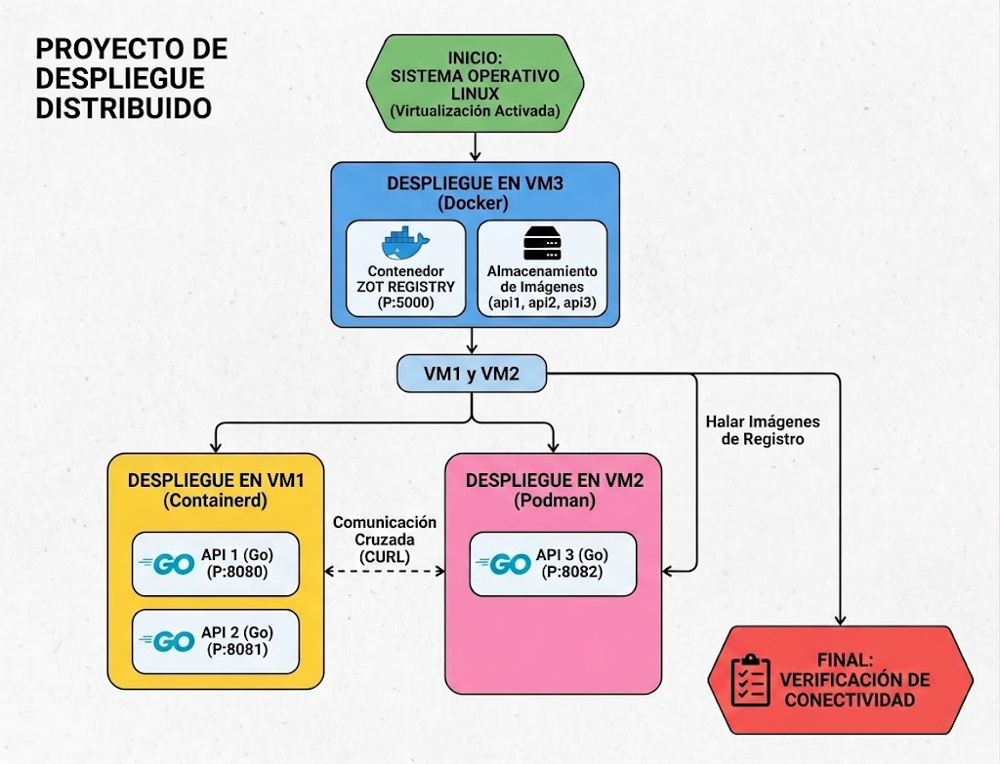

# Manual Técnico
## Proyecto 1 — Desarrollo, Conexión y Gestión de Contenedores en Entornos Virtualizados
**Sistemas Operativos 1 — USAC**

> Para ver los comandos paso a paso, está el documento aparte de Guía de Instalación. Aquí explico cómo armé el proyecto, por qué lo hice así, y qué resultados fui obteniendo.

---

## De qué se trata el proyecto

La idea era simular cómo se despliegan aplicaciones reales usando varios servidores conectados entre sí. Para esto usé 3 máquinas virtuales, cada una con un runtime distinto para manejar contenedores, y en cada una corrí una API en Go que puede preguntarle a las otras dos si están funcionando. Además, una de las VMs también tiene un registro de imágenes (Zot) para poder compartir las imágenes entre las 3 máquinas.

| VM | Hostname | IP | Runtime | Qué corre ahí |
|---|---|---|---|---|
| VM1 | `vm1-containerd` | `192.168.122.179` | Containerd + nerdctl | API1 (puerto 8080) |
| VM2 | `vm2-podman` | `192.168.122.241` | Podman | API2 (puerto 8081) |
| VM3 | `vm3-docker-zot` | `192.168.122.112` | Docker | API3 (puerto 8082) y Zot (puerto 5000) |

Las 3 VMs están en la misma red (la red NAT que crea libvirt por defecto), así que se pueden ver entre ellas sin ningún problema.

### Cómo se conectan entre sí




Cada API puede preguntarle a las otras dos "¿estás viva?" y recibe una respuesta confirmando si sí o si no.


### `main.go`

Es el programa que corre las 3 APIs — el mismo archivo, reutilizado para las tres, que se comporta diferente según cómo lo arranco (le paso qué número de API es, en qué VM está, y las direcciones de las otras dos APIs).

Este programa hace dos cosas:

1. Cuando alguien le pregunta si está "viva" (`/health`), responde con un mensaje confirmando que sí, junto con la hora, en qué VM está corriendo, y mi carnet.
2. Cuando alguien le pide que consulte a otra API (`/apiX/carnet/call-apiY`), el programa mismo le hace esa pregunta a la otra API por su cuenta, espera la respuesta, y si todo salió bien contesta que sí están conectadas; si la otra API no contestó (porque está apagada o algo falló), contesta que no, con un mensaje de error. Le puse un límite de 3 segundos de espera para que no se quede pegado esperando para siempre si la otra API no responde.

### `go.mod`

Es un archivo que todo proyecto en Go necesita — básicamente le dice al compilador cómo se llama el proyecto y qué versión de Go estoy usando. No tiene nada complicado, solo es un requisito técnico del lenguaje.

### `Dockerfile`

Es como una receta que le dice a Docker (o a Podman o nerdctl) los pasos para construir la imagen. Usé exactamente el mismo Dockerfile para las 3 APIs, sin cambiar nada — lo único distinto entre ellas es cómo las arranco después, no cómo las construyo.

Tiene dos partes:
1. Primero arranca de una imagen que ya trae el compilador de Go, copia mi código, y lo compila.
2. Después arranca de una imagen mucho más chiquita (Alpine Linux) y solo copia el programa ya compilado del paso anterior — sin llevarse el compilador ni nada más que no se necesite para correrlo.

Por eso las imágenes terminaron pesando tan poco.

### `config.json` (de Zot)

Es el archivo que le dice a Zot en qué puerto debe escuchar (5000) y en qué carpeta va a guardar las imágenes que le suban. Sin este archivo, Zot no sabría cómo comportarse al arrancar.

---


### El endpoint `/health`

Probé que las 3 APIs contestaran correctamente con el formato que pedía el enunciado — confirmando que estaban "arriba", con la hora, la VM, y mi carnet. Las 3 funcionaron bien.

### Que las APIs se hablen entre sí

Probé las 6 combinaciones posibles (cada API preguntándole a las otras dos), esta vez ya no en mi propia compu sino de verdad entre las 3 VMs por la red. Las 6 combinaciones funcionaron, confirmando que sí se pueden comunicar aunque estén en máquinas distintas con runtimes distintos.

### Qué pasa si una API se cae

Apagué una de las APIs a propósito y le pregunté a las otras dos si podían contactarla. Ambas contestaron correctamente que no, con el mensaje de error esperado — así confirmé que el manejo de errores funciona bien y no se queda pegado el programa esperando una respuesta que nunca va a llegar.

---

## Tamaño final de las imágenes

| Imagen | Construida con | Tamaño |
|---|---|---|
| `api1-202300559:v1` | nerdctl (containerd) | 18.59 MB |
| `api2-202300559:v1` | Podman | ~20 MB |
| `api3-202300559:v1` | Docker | 9.13 MB |

Las pequeñas diferencias de tamaño entre runtimes son normales, cada uno calcula/comprime un poco distinto, pero el contenido real es prácticamente el mismo.

---

## Problemas que me salieron y cómo los resolví

Aquí documento los errores reales que me fueron saliendo mientras hacía el proyecto, para que quede claro que no fue todo perfecto a la primera:

| Qué pasó | Por qué pasó | Cómo lo resolví |
|---|---|---|
| virt-manager no se podía conectar para administrar las VMs | Mi usuario no tenía permisos directos sobre libvirt (decidí no dárselos) | Lo abrí con permisos de administrador cada vez |
| El servicio de libvirt se apagaba solo justo después de iniciar | La instalación no terminó de crear un usuario interno que necesita el sistema | Reinstalé el paquete para forzar que se creara correctamente |
| No pude instalar el paquete de KVM con el nombre de siempre | En la versión de Ubuntu que uso, el paquete cambió de nombre | Instalé el paquete correcto con el nuevo nombre |
| No podía construir imágenes en la VM de containerd | Containerd no trae integrado algo para construir imágenes, solo para correrlas | Instalé aparte la herramienta que sí construye imágenes (BuildKit) |
| No podía correr contenedores en la VM de containerd por un tema de red | Faltaban unos plugins de red que containerd necesita y que no vienen incluidos | Los instalé aparte |
| Docker no aceptaba el nombre de mi imagen porque tenía mayúsculas | Los nombres de imágenes de Docker solo pueden ir en minúsculas, es una regla fija | Cambié el nombre a minúsculas |
| Al construir en otra VM me salió un error de sintaxis en mi código | Al copiar el archivo se me quedó mal cerrado un bloque de código | Corregí el archivo agregando lo que faltaba |
| No podía subir una imagen al registro Zot | El formato en que containerd empaqueta la imagen no era el que Zot esperaba | Convertí la imagen al formato correcto antes de subirla |

---


|Requisitos | Como se implemento |
|---|---|
| Instalación del entorno virtualizado (KVM) | Las 3 VMs quedaron funcionando, conectadas en red y accesibles por SSH |
| Instalación y prueba de los runtimes | Probé containerd, podman y docker cada uno con un contenedor de ejemplo |
| Desarrollo de las APIs en Go | Un solo código reutilizado, corriendo las 3 instancias al mismo tiempo |
| Endpoint `/health` | Responde con el formato exacto pedido, con mi carnet incluido |
| Dockerfiles y construcción de imágenes | Imágenes livianas, con nombres personalizados según cada API y mi carnet |
| Comunicación entre las APIs | Las 6 combinaciones posibles funcionaron correctamente por la red real |
| Registro privado (Zot) | Ya está configurado y funcionando; terminando de validar la subida de todas las imágenes |

---

## 8. Cómo está organizado el repositorio

```
202300559_LAB_SO1_2S2026/
├── README.md
└── proyecto1-so1/
    ├── api1/           # lo que se construyó en VM1
    ├── api2/           # lo que se construyó en VM2
    └── api3/           # lo que se construyó en VM3
```