# Manual Técnico — M.U.M.N.K8s

**Proyecto 3 — Sistemas Operativos 1**
**Universidad de San Carlos de Guatemala — Facultad de Ingeniería**

**Estudiante:** Douglas Alberto Ajú Mucía  — Carnet 202300559

**Repositorio:** `proyecto3/`

## Índice

1. [Arquitectura General](#1-arquitectura-general)
2. [Flujo Completo de Datos](#2-flujo-completo-de-datos)
3. [Configuración de Gateway API](#3-configuración-de-gateway-api)
4. [Comunicación REST y gRPC](#4-comunicación-rest-y-grpc)
5. [RabbitMQ](#5-rabbitmq)
6. [Operator (Valkey y Grafana)](#6-operator-valkey-y-grafana)
7. [HPA (Horizontal Pod Autoscaler)](#7-hpa-horizontal-pod-autoscaler)
8. [Zot — Publicación y Consumo de Imágenes](#8-zot--publicación-y-consumo-de-imágenes)
9. [OCI Artifact](#9-oci-artifact)
10. [Falco — Seguridad en Tiempo Real](#10-falco--seguridad-en-tiempo-real)
11. [Pruebas Realizadas y Conclusiones](#11-pruebas-realizadas-y-conclusiones)

---

## 1. Arquitectura General

El sistema simula la recepción y procesamiento de reportes militares en tiempo real. Está desplegado en Google Kubernetes Engine (GKE, nodos N1) y usa una VM separada (fuera del clúster) como registro de contenedores (Zot).

> — Diagrama de arquitectura general.
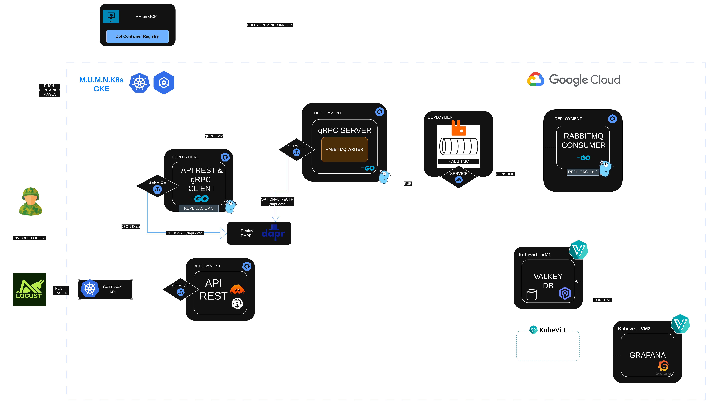


**Componentes:**

| Componente | Tecnología | Función |
|---|---|---|
| Locust | Python | Generador de carga, simula reportes militares vía HTTP POST |
| Gateway API | Kubernetes Gateway API | Expone el sistema (sustituye al Ingress Controller) |
| rust-api | Rust (Axum) | Recibe reportes de Locust en `/grpc-202300559`, reenvía al servicio Go |
| go-api (Deployment 1) | Go | Recibe de Rust, actúa como cliente gRPC, 2 contenedores |
| grpc-server + rabbitmq-writer (Deployment 2/3) | Go | Recibe gRPC, publica mensajes en RabbitMQ, 2 contenedores |
| RabbitMQ | — | Broker de mensajería principal (único sistema de colas del flujo base) |
| consumer | Go | Consume de RabbitMQ, calcula estadísticas y guarda en Valkey |
| Valkey | Redis-compatible | Almacenamiento de métricas: ZSET (top países), Hash (frecuencias), Stream (serie temporal GTM) |
| Grafana | — | Visualización de dashboards, datasource `redis-datasource` apuntando a Valkey |
| Operator | Operator SDK (Helm-based) | CRDs `ValkeyInstance` y `GrafanaInstance`, reconcilia ambos recursos dentro del clúster |
| Zot | OCI Registry | Registro de imágenes Docker y OCI Artifacts, VM Ubuntu fuera del clúster, HTTPS con Let's Encrypt |
| Falco | — | Seguridad en tiempo real, detección de accesos a archivos sensibles dentro de los pods |

---

## 2. Flujo Completo de Datos

1. **Locust** genera reportes JSON con la estructura:
   ```json
   {
     "country": "GTM",
     "warplanes_in_air": 42,
     "warships_in_water": 14,
     "timestamp": "2026-10-22T16:30:00Z"
   }
   ```
   y los envía por HTTP POST a la ruta `/grpc-202300559`, expuesta mediante el **Gateway API** (no mediante Ingress).

2. El **Gateway** enruta la petición al Service `rust-api-svc`, que balancea entre las réplicas del deployment `rust-api` (escalado por HPA, 1-3 réplicas).

3. **rust-api** valida el JSON y lo reenvía como petición HTTP interna al servicio Go `go-api` (Deployment 1), que actúa como cliente gRPC.

4. `go-api` convierte el reporte a un mensaje `WarReportRequest` (protobuf) y lo envía por **gRPC** al `grpc-server` (Deployment 2).

5. `grpc-server`, junto con su contenedor `rabbitmq-writer`, publica el mensaje en la cola `war_reports` de **RabbitMQ**.

6. El **consumer** (Go) consume mensajes de `war_reports` con 4 workers concurrentes, calcula en una sola transacción (pipeline de Redis) sobre **Valkey**:
   - Máximos y mínimos de aviones/barcos (vía script Lua `luaMaxMin`).
   - Moda de aviones/barcos (vía script Lua `luaMode`, ver sección 11).
   - Suma acumulada por país en los ZSET `top:planes` / `top:ships` (`ZINCRBY`).
   - Conteo de reportes por país (`HINCRBY reports:count`).
   - Si el país es el asignado (GTM), agrega un punto a la serie de tiempo `gtm:series` (`XADD`).

7. **Grafana**, mediante el datasource `redis-datasource` (plugin), consulta Valkey en tiempo real y renderiza los 11 paneles requeridos.

> Locust corriendo contra el Gateway (no contra un port-forward), con 0 fallas.
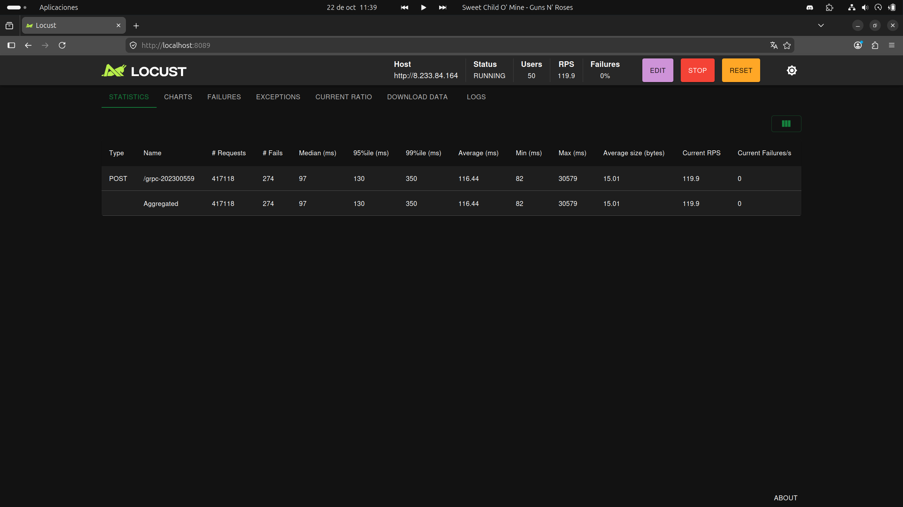

---

## 3. Configuración de Gateway API

Se usa **Kubernetes Gateway API** en lugar de Ingress Controller, por indicación explícita del auxiliar (el documento del enunciado menciona "Ingress" en un punto de la rúbrica, pero la guía de calificación y el auxiliar exigen Gateway API).

**Recursos desplegados:**
- `Gateway` (`mumn-gateway`, clase `gke-l7-global-external-managed`), con IP externa fija asignada por GCP.
- `HTTPRoute` (`mumn-route`), que enruta la ruta `/grpc-#carnet` (en este caso `/grpc-202300559`) hacia el Service `rust-api-svc`.

> — Salida de `kubectl get gateway,httproute -n mumn` mostrando `PROGRAMMED: True` y la IP externa.


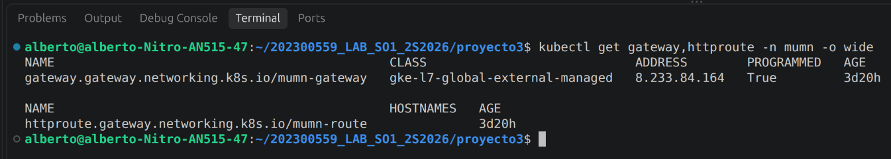

**Verificación directa (sin pasar por Locust):**
```bash
curl -X POST http://<IP-DEL-GATEWAY>/grpc-202300559 \
  -H "Content-Type: application/json" \
  -d '{"country":"GTM","warplanes_in_air":10,"warships_in_water":5,"timestamp":"2026-10-22T16:30:00Z"}'
# {"status":"ok"}  HTTP 200
```

---

## 4. Comunicación REST y gRPC

**REST (Locust → rust-api → go-api):** HTTP/JSON, usado para la ingesta inicial, porque Locust solo genera carga HTTP.

**gRPC (go-api → grpc-server):** Comunicación interna entre microservicios Go, con un contrato definido en Protocol Buffers:

```protobuf
syntax = "proto3";
package wartweets;

message WarReportRequest {
  Countries country = 1;
  int32 warplanes_in_air = 2;
  int32 warships_in_water = 3;
  string timestamp = 4;
}

enum Countries {
  countries_unknown = 0;
  usa = 1;
  rus = 2;
  chn = 3;
  esp = 4;
  gtm = 5;
}

message WarReportResponse {
  string status = 1;
}

service WarReportService {
  rpc SendReport (WarReportRequest) returns (WarReportResponse);
}
```

Se eligió gRPC para la comunicación interna por su serialización binaria eficiente (protobuf) y el contrato fuertemente tipado entre servicios Go, mientras que REST se usa únicamente en el borde del sistema (API pública expuesta a Locust vía Gateway).

---

## 5. RabbitMQ

RabbitMQ es el único sistema de colas usado en el flujo principal (obligatorio según el enunciado).

- **Cola:** `war_reports`, declarada durable.
- **Publicador:** contenedor `rabbitmq-writer` dentro del Deployment 2 (`grpc-server`).
- **Consumidor:** Deployment `consumer` (Go), con `Qos(50, 0, false)` (prefetch de 50 mensajes) y 4 goroutines worker concurrentes leyendo del mismo canal.
- **Confirmación:** cada mensaje se reconoce (`Ack`) solo después de guardarse exitosamente en Valkey; si falla el guardado, se hace `Nack` con reintento (`requeue: true`).

>— Management UI de RabbitMQ .

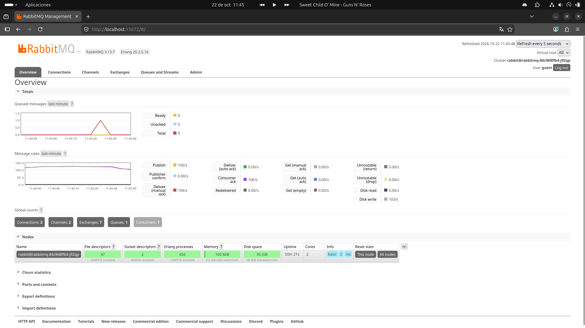

---

## 6. Operator (Valkey y Grafana)

Se construyó un único **Operator** (Operator SDK, Helm-based) que administra dos Custom Resources independientes dentro del mismo clúster: `ValkeyInstance` y `GrafanaInstance`.

### 6.1 CRDs

- **`ValkeyInstance`**: encapsula un Helm chart (`helm-charts/valkeyinstance/`) con un `StatefulSet` + `PersistentVolumeClaim` (1Gi) para persistencia de datos, y su `Service` (`valkey:6379`).
- **`GrafanaInstance`**: encapsula un Helm chart (`helm-charts/grafanainstance/`) con `Deployment`, `Service` (LoadBalancer), `ConfigMap` de datasources (apuntando a Valkey) y `ConfigMap` del dashboard (JSON provisionado).


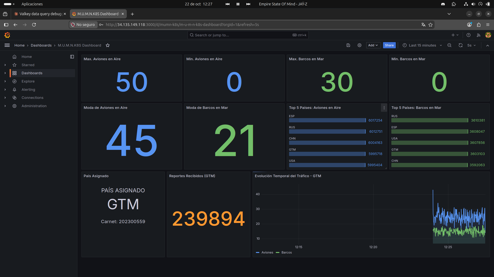


### 6.2 Lógica de reconciliación

El Operator (basado en `quay.io/operator-framework/helm-operator`) observa los Custom Resources `ValkeyInstance` y `GrafanaInstance`; cuando detecta una creación, actualización o eliminación, renderiza el Helm chart correspondiente con los valores del CR y aplica (`helm upgrade --install`) los recursos resultantes contra el clúster, garantizando que el estado real converja al estado deseado declarado en el CR.

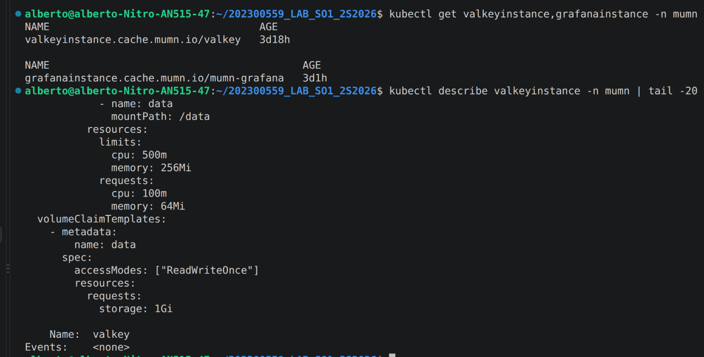


## 7. HPA (Horizontal Pod Autoscaler)

Configurado sobre el Deployment `rust-api`:

```yaml
minReplicas: 1
maxReplicas: 3
targetCPUUtilizationPercentage: 30
```

Bajo carga generada por Locust (50 usuarios concurrentes contra el Gateway), el HPA escaló correctamente de 1 a 3 réplicas:

```
TARGETS        REPLICAS
cpu: 10%/30%   1
cpu: 46%/30%   1   <- supera el umbral, dispara el escalado
cpu: 46%/30%   2
cpu: 34%/30%   2
cpu: 34%/30%   3
cpu: 20%/30%   3   <- se estabiliza cerca del umbral con 3 réplicas
```


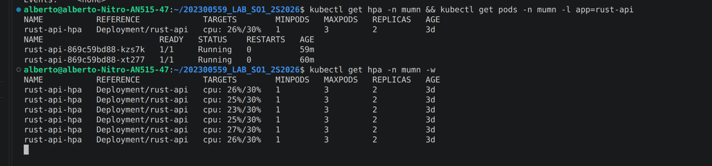

---

## 8. Zot — Publicación y Consumo de Imágenes

Zot corre como servicio systemd (binario nativo, **no** contenedor Docker) en una VM Ubuntu de GCP, fuera del clúster de GKE, con TLS (Let's Encrypt) sobre el dominio `34-132-3-94.nip.io` (nip.io resuelve automáticamente al IP de la VM).

**Publicación de una imagen (ejemplo, consumer):**
```bash
docker build -f Dockerfile.consumer -t 34-132-3-94.nip.io/mumn/consumer:v3 .
docker push 34-132-3-94.nip.io/mumn/consumer:v3
```

**Consumo desde un manifiesto de Kubernetes:**
```yaml
containers:
  - name: consumer
    image: 34-132-3-94.nip.io/mumn/consumer:v3
```

Todas las imágenes del proyecto (rust-api, go-api, go-api-grpcclient, grpc-server, rabbitmq-writer, consumer, valkey, valkey-operator) se publican y consumen exclusivamente desde este registro.

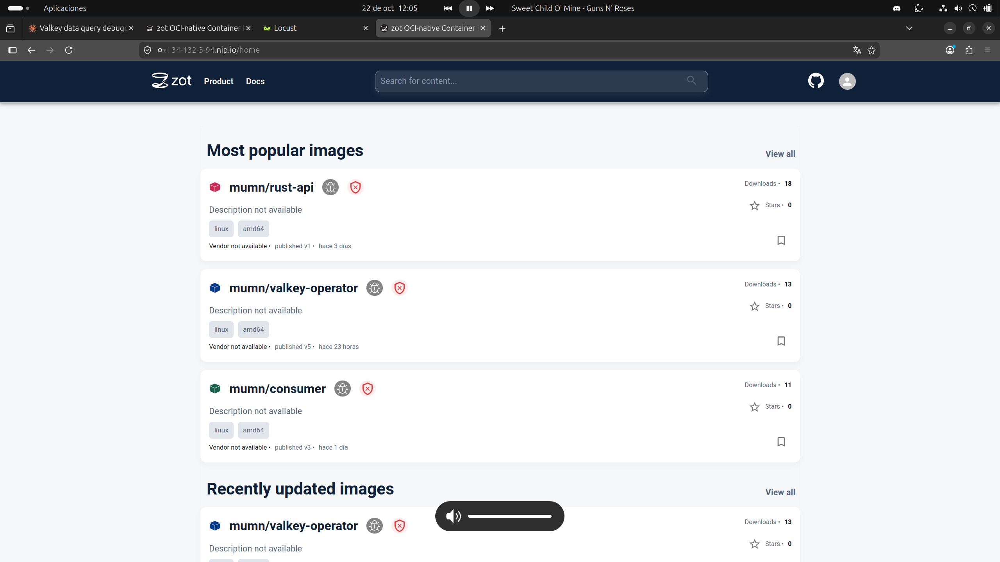

---

## 9. OCI Artifact

Además de las imágenes de contenedor, se publicó en Zot un **OCI Artifact** un archivo de configuración JSON que define los países simulados y los rangos válidos de la simulación.

**Archivo:** `countries-config.json`
```json
{
  "countries": ["USA", "RUS", "CHN", "ESP", "GTM"],
  "ranges": {
    "warplanes_in_air": { "min": 0, "max": 50 },
    "warships_in_water": { "min": 0, "max": 30 }
  },
  "assigned_country": "GTM"
}
```

**Uso:** sirve como fuente única de verdad de los parámetros de simulación (lista de países válidos y rangos de generación), documentando de forma versionada y auditable los mismos valores que el enunciado define como "rangos sugeridos", en vez de tenerlos hardcodeados sin referencia en el código de Locust.

**Publicación:**
```bash
oras push 34-132-3-94.nip.io/mumn/config:v1 \
  countries-config.json:application/json
```

**Consumo (descarga del archivo de entrada):**
```bash
oras pull 34-132-3-94.nip.io/mumn/config:v1
```

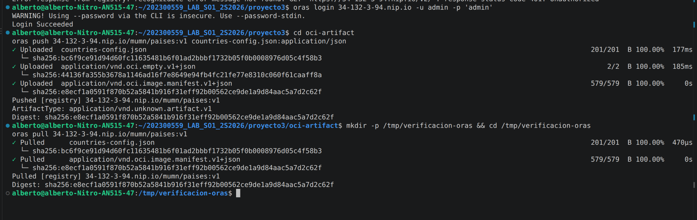


---

## 10. Falco — Seguridad en Tiempo Real

Se instaló Falco en el clúster vía Helm (namespace `falco`) y se creó una regla personalizada para detectar lectura de archivos sensibles dentro de los pods del namespace `mumn`.

**Regla personalizada (`falco-custom-values.yaml`):**
```yaml
driver:
  kind: modern_ebpf
tty: true
falco:
  rule_matching: all
customRules:
  rules-mumn.yaml: |-
    - rule: Lectura de archivo sensible en pods MUMN
      desc: Detecta la apertura para lectura de /etc/shadow dentro de un contenedor del namespace mumn
      condition: >
        open_read
        and fd.name=/etc/shadow
        and k8s.ns.name=mumn
      output: >
        ALERTA MUMN: lectura de /etc/shadow (usuario=%user.name comando=%proc.cmdline pod=%k8s.pod.name ns=%k8s.ns.name contenedor=%container.name imagen=%container.image.repository)
      priority: WARNING
      tags: [mumn, filesystem, sensitive]
```

**Simulación de la amenaza:**
```bash
kubectl exec -n mumn <pod-rust-api> -- cat /etc/shadow
```

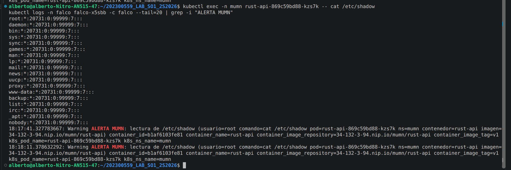

---

## 11. Pruebas Realizadas y Conclusiones

### 11.1 Prueba de carga con HPA (1 vs 3 réplicas)

Ver sección 7: con 50 usuarios concurrentes de Locust contra el Gateway, el HPA de `rust-api` escaló de 1 a 3 réplicas en segundos, estabilizándose con CPU cercano al umbral configurado (30%). El sistema procesó miles de reportes sin fallas (0% failure rate reportado por Locust).

### 11.2 Prueba de 1 vs 2 réplicas en `grpc-server`

Se probó el comportamiento del `grpc-server` con 1 y luego 2 réplicas bajo la misma carga. **Hallazgo:** no se observó mejora real de rendimiento al duplicar las réplicas, porque la conexión gRPC persistente que usa `go-api` (cliente) queda fija a un único pod del `Service` de tipo `ClusterIP` — Kubernetes balancea por conexión TCP (al establecerse), no por petición individual, así que todo el tráfico de una conexión gRPC de larga duración sigue yendo al mismo pod backend aunque existan réplicas adicionales. Una solución posible (no implementada por límite de tiempo) sería usar un `Service` headless junto con balanceo round-robin a nivel de cliente gRPC.

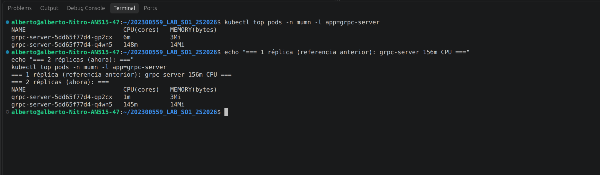


### 11.3 Conclusiones

- El sistema cumple con el flujo distribuido completo: Locust → Gateway API → REST (Rust) → gRPC (Go) → RabbitMQ → Consumer (Go) → Valkey → Grafana, con todas las imágenes publicadas y consumidas desde un registro OCI propio (Zot) fuera del clúster.
- El Operator personalizado administra tanto Valkey como Grafana de forma completamente declarativa mediante Custom Resources, cumpliendo con el requisito de no usar instalaciones manuales ni máquinas virtuales para estos componentes.
- El HPA demuestra escalado horizontal real y medible bajo carga.
- Se identificaron y corrigieron dos problemas no triviales durante el desarrollo: la supresión de reglas personalizadas de Falco por el modo `rule_matching: first`, y el cálculo incorrecto de la moda causado por una limitación del modo de comando crudo del plugin de Grafana — ambos con causa raíz diagnosticada contra los datos reales, no solo "arreglados a ciegas".
- Limitación conocida y documentada (no bloqueante): el balanceo de conexiones gRPC persistentes no se beneficia de réplicas adicionales del `Service` tipo `ClusterIP` por defecto de Kubernetes.